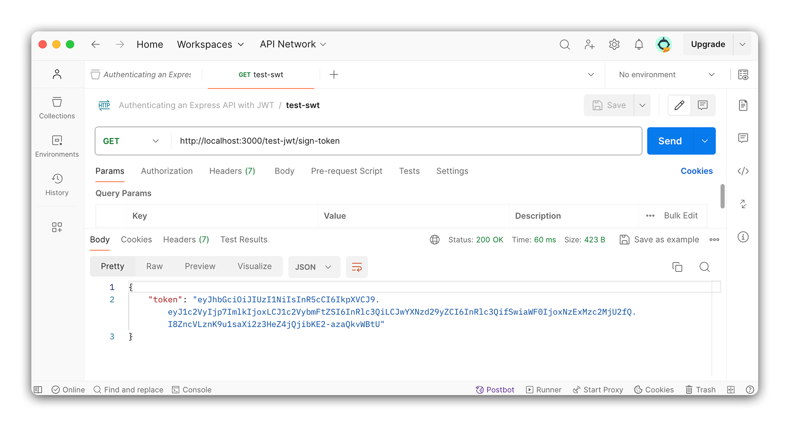
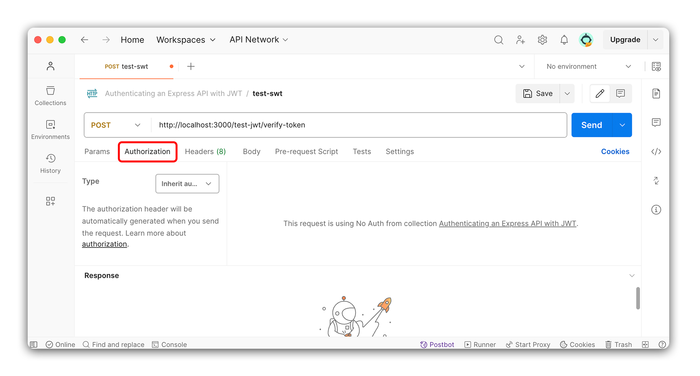
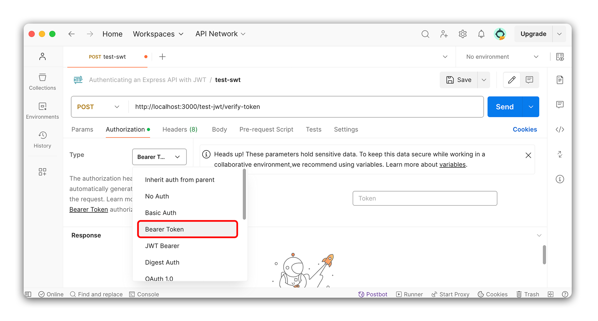

<h1>
  <span class="headline">JWT Authentication in Express APIs</span>
  <span class="subhead">Setting Up JWTs</span>
</h1>

**Learning objective:** By the end of this lesson, students will be able to explain how JSON Web Tokens use signing and verifying to authenticate users in an Express application.

## JSON Web Tokens (JWTs) in Express

Before creating routes to handle signing up and signing in users, let's look at how we can use [JSON Web Tokens (JWT)](https://www.npmjs.com/package/jsonwebtoken) in an Express application.

Like all external tools, we must first install the `jsonwebtoken` package.

```bash
npm i jsonwebtoken
```

JWTs are a way to transmit information between parties as a JSON object securely. The information sent can be trusted because it includes a digital signature. JWTs can be signed using a secret (with the HMAC algorithm) or a public/private key pair using the RSA or ECDSA algorithms. That same secret or public/private key pair can be used to verify the token's authenticity.

> 💡 You don't need to know the details of these algorithms to use them, but it is essential to be able to speak to details such as what algorithm your apps implement - which is HMAC in this case (meaning our JWTs will be signed using a secret).
>
> At this stage, you should not try to deeply understand the algorithms that can be used to create JWTs or worry about writing the code that can handle authentication from scratch. However, you should focus on being able to competently speak to how you implement authentication in your apps. This gives others confidence in your abilities and that you understand your code. When you are ready to dive deeper into the algorithms, you can find more information in the [JWT.io documentation](https://jwt.io/introduction/).

Using JWTs involves two main actions:

- **Signing**: This is the process of creating a JWT and sending it to the client. This token is a secure way for the server to recognize the client in future transactions.
- **Verifying**: This involves receiving a JWT from the client and verifying its authenticity and integrity to ensure the server issued it and hasn't been tampered with.

To practice these concepts, we'll set up two routes in our Express application:

- A route for **signing** - where we create a JWT and send it to the client.
- A route for **verifying** - where we check the validity of a received JWT.

These routes are for learning purposes and will not be part of the final application. However, they are crucial for understanding how to integrate JWTs into your Express projects.

## Signing a JWT

Create a new `controllers` directory and touch a new file inside it called `test-jwt.js`.

```bash
mkdir controllers
touch controllers/test-jwt.js
```

Once created, let's set up the file with a `router` and an empty GET route.
This route should follow the structure below:

- Route: `/sign-token`
- Method: `GET`
- Response: `{ message: 'You are authorized!' }`

```javascript
// controllers/test-jwt.js

const express = require('express');
const router = express.Router();

router.get('/sign-token', (req, res) => {
  res.json({ message: 'You are authorized!' });
});

module.exports = router;
```

After we have set up the route, we need to require and use it in our server file. Open `server.js` and require and use the `test-jwt` route:

```javascript
// server.js

// ... other requires above
const testJwtRouter = require('./controllers/test-jwt');

// ... other middleware

// Routes go here
app.use('/test-jwt', testJwtRouter);
```

Open up Postman and make a GET request to `http://localhost:3000/test-jwt/sign-token`. The response should show the message `You are authorized!`. Make sure you can see the message before you move on.

Now that we have a route that sends a test message let's dive into the JWT signing process. The `jsonwebtoken` package has a method called `sign()` that we can use to create a JWT. We will use this method to create a JWT and send it to the client.

The `sign()` method takes three arguments:

1. The payload to be included in the JWT.
2. The secret key to sign the JWT with.
3. An (optional) options object.

The **payload** is the information we want to include in the JWT. This can be any JSON object. We want to specify that this token belongs to a specific user and no one else. For now, we will include a mock user object with a `username`, `password`, and `_id` field.

The **secret key** is a string used to sign the JWT. This key is unique to our application and should be kept secret. We'll be storing it in our `.env` file.

The **options object** is an object that allows us to specify how the JWT should be created. We can specify the algorithm to use, the expiration time, and other options. We will use the default options for now, so we will not use this argument.

Now that we understand the `sign()` method, let's use it in our `/test-jwt/sign-token` route.

Remove the `res.json()` method from the route and replace it with a mock user object:

```javascript
// controllers/test-jwt.js
router.get('/sign-token', (req, res) => {
  // Mock user object added
  const user = {
    _id: 1,
    username: 'test',
    password: 'test',
  };
});
```

This mock user object will be a stand-in for a user document in our database; we'll use it as the payload for our JWT.

We have our **payload**; now, we must create the **secret key**. Inside of your `.env` file, add a new key-value pair for the secret key:

```bash
JWT_SECRET=L2d6ZjAV
```

Before moving on, let's talk about the secret key. This key can be anything as long as it is a string. This could be as simple as the phrase `supersecret` or `catsAreCool`, or as complex as `4ilK]I+X+;n2+g"*>AMQc{p99)9DB@a@`.

As the name implies, the key to the secret key should be secret and not shared or left in your code where someone would have access to view it. This is why we're storing it in the `.env` file, which you should always be sure to include in your `.gitignore` file to prevent it from surfacing on GitHub.

> 🧠 If you want a more secure secret key, you can use node's built-in `crypto` module to generate strong random data. Running this command in your terminal will generate a strong secret that you can use:
>
> ```bash
> node -e "console.log(require('crypto').randomBytes(256).toString('base64'));"
> ```
>
> Generating longer and cryptographically strong keys is more necessary in production environments where security is a top priority.

We now have both required arguments for the `sign()` method. Next, let's require in the `jsonwebtoken` package at the top of the `test-jwt.js` file:

```javascript
// controllers/test-jwt.js
const express = require('express');
const router = express.Router();
// Add in the jsonwebtoken package
const jwt = require('jsonwebtoken');
```

Pass both the mock user object and the secret key to the `sign()` method and assign the result to a variable called `token`:

```javascript
// controllers/test-jwt.js
router.get('/sign-token', (req, res) => {
  const user = {
    id: 1,
    username: 'test',
    password: 'test',
  };
  // Create a token using the sign method
  const token = jwt.sign({ user }, process.env.JWT_SECRET);
});
```

Send the token back to the client in the response:

```javascript
// controllers/test-jwt.js
router.get('/sign-token', (req, res) => {
  const user = {
    id: 1,
    username: 'test',
    password: 'test',
  };
  const token = jwt.sign({ user }, process.env.JWT_SECRET);

  // Send the token back to the client
  res.json({ token });
});
```

Using Postman, make a GET request to `http://localhost:3000/test-jwt/sign-token`. You should see a response with a token in it. Make sure you can see the token before you move on.



We have successfully created a JWT and sent it to the client! We will use this token in the next lesson to verify the user.

## Verifying a JWT

Like the signing route, our verifying route will not be a part of our finished application and will just be used for testing.

Inside the `test-jwt.js` file, create a new route to receive a POST request. This route should follow the structure below:

- Route: `/verify-token`
- Method: `POST`
- Response Body: `{ message: 'Token is valid' }`

```javascript
// controllers/test-jwt.js
router.post('/verify-token', (req, res) => {
  res.json({ message: 'Token is valid.' });
});
```

Using Postman, make a POST request to `http://localhost:3000/test-jwt/verify-token`. You should see a response with the message `Token is valid`. Make sure you can see the message before you move on.

Next, we'll use the `verify()` method to verify the token. The `verify()` method takes three arguments:

- The token to verify.
- The secret key to verify the token with.
- An (optional) options object.

We will use the `verify()` method to verify the token we created in the previous route. We will also use the secret key created in the `.env` file.

To send the token to the server, we'll once again use Postman. Open Postman and copy the token you were sent in the previous route. If you have lost that token, send another request to the same test route and get another token.

Still in Postman, navigate to the request you created to test the `verify-token` route. Under the URL bar, select the `Authorization` tab.



Once in the `Authorization` tab, select `Bearer Token` from the dropdown. Paste the token you copied from the previous route in the input field that appears.



When we send a request to the `verify-token` route, the token will be included in the request's headers. We can access this token in the route handler using `req.headers.authorization`.

In our code, let's return to our `verify-token` route. Remove the placeholder message from `res.json()` and replace it with a new `token` variable from `req.headers.authorization`:

```javascript
// controllers/test-jwt.js
router.post('/verify-token', (req, res) => {
  const token = req.headers.authorization;

  res.json({ token });
});
```

Test with Postman to ensure you can see the token in the response. You should see something like:

```json
{
  "token": "Bearer <token here>"
}
```

Notice the word `Bearer` is in front of the token. This is a convention that is used to specify the type of token that is being sent. We must remove this word before verifying the token because the `verify()` method only expects the token with nothing else prepended.

We'll use the `split` method to remove the word `Bearer` from the token. This method will split the string into an array of strings. We can then grab the second item in the array, which will be the token.

```javascript
// controllers/test-jwt.js
router.post('/verify-token', (req, res) => {
  const token = req.headers.authorization.split(' ')[1];

  res.json({ token });
});
```

Testing this with Postman again, we can see that we get back the token without the word `Bearer` in front of it.

Now that we have the token, let's verify it's correct using the `verify()` method from the `jsonwebtoken` package. This method will intake the token and the secret key and return the payload used to create the token. If the token is invalid, the method will throw an error:

```javascript
// controllers/test-jwt.js

router.post('/verify-token', (req, res) => {
  try {
    const token = req.headers.authorization.split(' ')[1];
    // Add in verify method
    const decoded = jwt.verify(token, process.env.JWT_SECRET);

    res.json({ decoded });
  } catch (err) {
    res.status(401).json({ err: 'Invalid token.' });
  }
});
```

Using Postman, make a POST request to `http://localhost:3000/test-jwt/verify-token`. You should see a response with the payload used to create the token. Notice that the payload is the mock user we created in the previous route! This will come in handy when we start to use JWTs for authentication. In the next section, we'll take these ideas of signing and verifying JWTs and apply them to our application.
